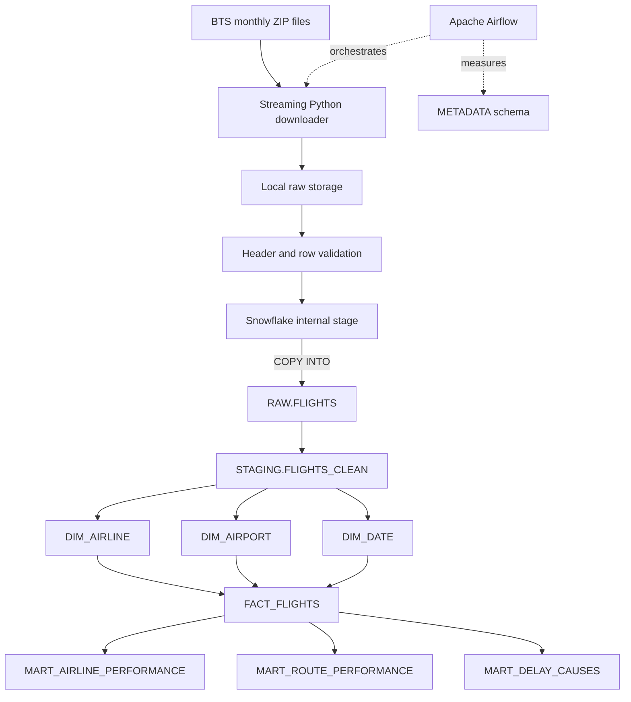

# US Airline Performance Data Warehouse

An incremental data warehouse for U.S. domestic flight performance, built with Python,
Snowflake, SQL, Apache Airflow, and Docker. The project ingests one Bureau of Transportation
Statistics (BTS) reporting-carrier file at a time and turns it into a dimensional model and
three analytics marts.

Author: **Aneesh Mokashi**

## Problem

Monthly airline files are useful on their own, but they do not answer cross-month questions
reliably without repeatable ingestion, type normalization, de-duplication, and an analytical
model. This pipeline provides that missing layer while keeping normal runs incremental: a month
with a successful load record is skipped, and a forced rerun updates the same fact grain rather
than adding duplicate flights.

The intended portfolio scope is January 2023 through December 2024. The range is configurable,
and a 2024-only run uses the same architecture.

## Architecture



No S3, AWS account, Terraform, Spark cluster, or external quality framework is required.
Snowflake uses an X-Small warehouse with a 60-second auto-suspend setting.

## Dataset

The source is the U.S. Department of Transportation Bureau of Transportation Statistics
[Reporting Carrier On-Time Performance dataset](https://www.transtats.bts.gov/DL_SelectFields.aspx?gnoyr_VQ=FGJ).
The downloader uses the agency's public
[pre-zipped monthly file directory](https://transtats.bts.gov/PREZIP/) and retains the archive
and extracted CSV under `data/raw/YYYY-MM/`.

The default configuration is:

```text
PIPELINE_START_MONTH=2023-01
PIPELINE_END_MONTH=2024-12
```

No row count is hardcoded. The authoritative total is always:

```sql
SELECT COUNT(*)
FROM AIRLINE_PERFORMANCE.ANALYTICS.FACT_FLIGHTS;
```

## Warehouse Design

| Object | Grain |
|---|---|
| `RAW.FLIGHTS` | One row from the currently loaded BTS monthly source file |
| `STAGING.FLIGHTS_CLEAN` | One valid flight segment per date, carrier, flight number, route, and scheduled departure |
| `ANALYTICS.FACT_FLIGHTS` | One scheduled domestic flight segment |
| `ANALYTICS.DIM_AIRLINE` | One reporting carrier code |
| `ANALYTICS.DIM_AIRPORT` | One BTS airport identifier |
| `ANALYTICS.DIM_DATE` | One calendar date represented by a loaded flight |
| `ANALYTICS.MART_AIRLINE_PERFORMANCE` | One airline across all loaded months |
| `ANALYTICS.MART_ROUTE_PERFORMANCE` | One directional origin-destination route |
| `ANALYTICS.MART_DELAY_CAUSES` | One airline and calendar month |

Dimensions use Snowflake-generated surrogate keys. The fact's deterministic SHA-256 key is
derived from the natural flight grain and makes `MERGE` reruns idempotent. Source file,
checksum, source month, run ID, and timestamps retain lineage through the layers.

## Pipeline Workflow

The Airflow DAG exposes ten readable tasks:

```text
check_month
  -> download_data
  -> validate_raw_file
  -> upload_to_snowflake_stage
  -> load_raw
  -> transform_staging
  -> merge_fact_dimensions
  -> build_analytics_marts
  -> validate_counts
  -> record_pipeline_metrics
```

Tasks retry twice after a five-minute delay, the DAG allows only one active run, and its
failure callback records the failed task and run status in Snowflake. A manual trigger accepts
`source_month` in `YYYY-MM` format plus an optional `force` flag. With the default `AUTO` value,
the monthly schedule resolves the month two calendar months before its interval end, as
documented in [Airflow operations](docs/operations.md).

## Incremental Loading

`METADATA.PIPELINE_LOADS` contains the latest successful result for each source month. Before
downloading anything, `check_month` looks for that marker:

```text
successful month + force=false -> skip
new month                         -> process
force=true                        -> replace that month's raw/staging data and MERGE the fact
```

The internal stage path includes the source month and SHA-256 file checksum. Raw and staging
replacement is scoped to one month; dimensions and facts use `MERGE`. Therefore a normal new
month never truncates historical warehouse data.

Run the executable idempotency check with:

```bash
airline-warehouse idempotency-test --month 2024-01
```

It writes `reports/idempotency.json` with the fact count after both forced runs and fails if the
counts differ.

## Data Quality

Before upload, Python streams the entire CSV and checks file presence, non-zero rows, required
columns, declared/source month agreement, route identifiers, dates, distance bounds, and
duplicate natural keys. Snowflake then measures:

- source-to-raw row reconciliation;
- raw-to-staging reconciliation, accounting for invalid rows and duplicates;
- staging-to-fact reconciliation;
- duplicate natural keys; and
- invalid source rows.

Each result is persisted to `METADATA.DATA_QUALITY_RESULTS`. Reconciliation failures stop the
run; measurable source defects are stored as warnings and excluded from the fact table.

## Analytics

`MART_AIRLINE_PERFORMANCE` summarizes flights, cancellations, delays, average arrival delay,
and on-time percentage. A non-cancelled, non-diverted flight is on time when its arrival delay
is **15 minutes or less**, as specified for this project.

`MART_ROUTE_PERFORMANCE` adds directional route volume, delay, cancellation rate, and elapsed
time. `MART_DELAY_CAUSES` aggregates carrier, weather, National Airspace System, security, and
late-aircraft delay minutes by airline-month.

Example:

```sql
SELECT AIRLINE, TOTAL_FLIGHTS, ON_TIME_PERCENTAGE
FROM AIRLINE_PERFORMANCE.ANALYTICS.MART_AIRLINE_PERFORMANCE
ORDER BY ON_TIME_PERCENTAGE DESC;
```

## Performance Results

No benchmark numbers are committed before a real execution. After a successful warehouse run,
generate the result artifacts directly from Snowflake:

```bash
airline-warehouse report \
  --output reports/pipeline_metrics.json \
  --markdown reports/benchmark.md
```

The generated table includes records, months, file bytes, duplicates, rejected rows, full and
incremental runtimes, average monthly runtime, dimensions, and analytical query timings. A
missing benchmark is written as `null` / `Not measured`, never as an estimate.

For the requested full-versus-incremental comparison, see
[Benchmarking](docs/benchmarking.md). The reset command is deliberately guarded by
`--confirm-reset` because it clears all project-owned warehouse rows.

## Setup

Requirements: Python 3.10+, Docker with Compose, and a Snowflake account.

```bash
cp .env.example .env
python3 -m venv .venv
source .venv/bin/activate
python3 -m pip install -e '.[dev]'
pytest
```

Download and locally validate a month without Snowflake credentials:

```bash
airline-warehouse download --month 2024-01
```

Load one month or the default historical range:

```bash
airline-warehouse load-month --month 2024-01
airline-warehouse backfill --start 2023-01 --end 2024-12
```

## Airflow

Populate `.env`, initialize Airflow, and start the scheduler and web server:

```bash
make airflow-up
```

Open `http://localhost:8080`, sign in with the local-only credentials `airflow` / `airflow`,
unpause `airline_performance_monthly`, and trigger it with:

```json
{"source_month": "2024-01", "force": false}
```

Stop the local services without deleting their Postgres volume:

```bash
make airflow-down
```

## Snowflake Configuration

1. Run [`sql/setup/00_bootstrap.sql`](sql/setup/00_bootstrap.sql) in a Snowflake worksheet as
   `ACCOUNTADMIN`. It creates the project role, X-Small warehouse, database, and grants the role
   to the executing user.
2. Copy `.env.example` to `.env` and supply `SNOWFLAKE_ACCOUNT`, `SNOWFLAKE_USER`, and
   `SNOWFLAKE_PASSWORD`. Do not commit `.env`.
3. Create the schemas, stage, tables, and views:

```bash
airline-warehouse init
```

The runtime also expects these configurable names: `SNOWFLAKE_DATABASE`,
`SNOWFLAKE_WAREHOUSE`, `SNOWFLAKE_ROLE`, all four schema variables, and `SNOWFLAKE_STAGE`.
See `.env.example` for the complete list.

## Project Structure

```text
airflow/                  Docker Compose and the monthly DAG
src/airline_warehouse/    Downloader, validation, Snowflake service, pipeline, CLI, reports
sql/setup/                Account bootstrap and warehouse objects
sql/raw/                  Internal-stage COPY and month-scoped raw replacement
sql/staging/              Casting, validation, derived fields, de-duplication
sql/dimensions/           Airline, airport, and date MERGEs
sql/facts/                Idempotent flight fact MERGE
sql/marts/                Three analytical aggregates
tests/unit/               Fast local behavior and SQL contract tests
tests/integration/        Opt-in real-Snowflake idempotency test
docs/                     Operations, model, benchmarking, and screenshot guide
data/raw/                 Git-ignored BTS downloads
reports/                  Git-ignored measured output artifacts
```

## Reproducibility

- Python dependencies and the Airflow image are pinned.
- Every monthly file is identified by SHA-256.
- `METADATA.PIPELINE_RUNS` stores measured stage durations and row counts.
- `METADATA.PIPELINE_LOADS` is the incremental checkpoint.
- No source data, credentials, generated results, or invented metrics are versioned.
- `pytest` covers month ranges, official URL construction, ZIP extraction, streaming file
  validation, SQL contracts, skip behavior, and pipeline task order.
- The real integration test is opt-in:

```bash
RUN_SNOWFLAKE_INTEGRATION=1 IDEMPOTENCY_MONTH=2024-01 pytest -m integration
```

This codebase is an independent implementation. The project architecture was informed by
common raw/staging/mart warehouse patterns; no external repository source files or documentation
were copied.
